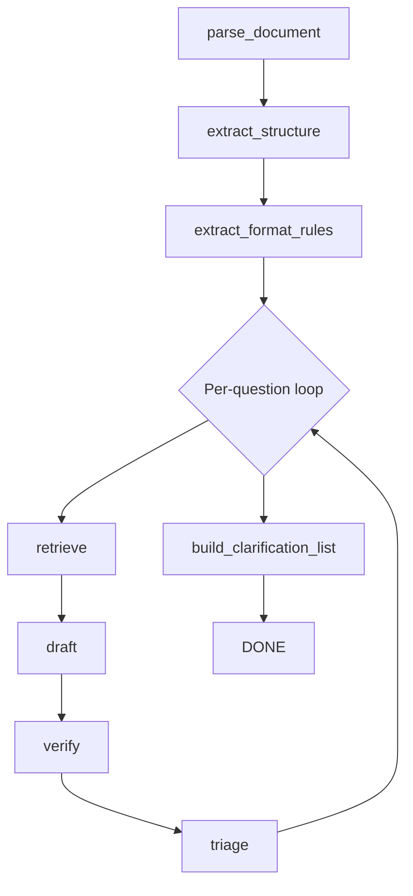
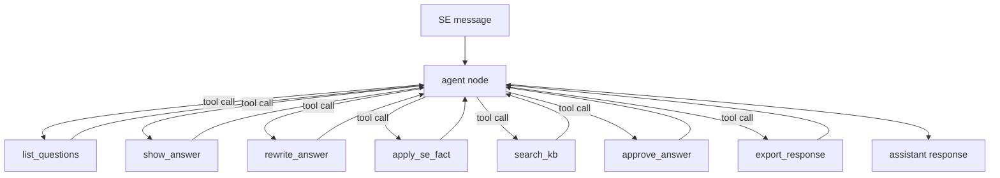

# Architecture

## Component Overview

```
┌─────────────────────────────┐
│   Streamlit Frontend        │  Port 8501
│   (streamlit_app.py)        │
│   httpx → FastAPI backend   │
└────────────┬────────────────┘
             │ HTTP
┌────────────▼────────────────┐
│   FastAPI Backend           │  Port 8000
│   (backend/app/main.py)     │
│                             │
│  ┌─────────┐  ┌──────────┐  │
│  │ analyze │  │  chat    │  │
│  │ graph   │  │  graph   │  │
│  │(LangGraph)  (LangGraph)  │
│  └────┬────┘  └────┬─────┘  │
│       │            │        │
│  ┌────▼────────────▼──────┐ │
│  │     Services Layer     │ │
│  │ parser / kb_ingest /   │ │
│  │ retrieval / redaction  │ │
│  │ exporter / formatting  │ │
│  └────┬────────────┬──────┘ │
│       │            │        │
│  ┌────▼───┐  ┌─────▼──────┐ │
│  │ SQLite │  │   Chroma   │ │
│  │(SQLAlch│  │(Vector DB) │ │
│  └────────┘  └────────────┘ │
└─────────────────────────────┘
```

## Data Flow

1. SE uploads RFP via Streamlit → POST /sessions/{id}/rfp
2. SE triggers analysis → POST /sessions/{id}/analyze
3. Backend runs `analyze_graph` (LangGraph):
   - parse_document → extract_structure → extract_format_rules
   - Per-question (bounded concurrency): retrieve → draft → verify → triage
   - build_clarification_list
4. Questions, answers, clarifications persisted to SQLite
5. SE reviews in Streamlit chat/questions tabs
6. Chat graph handles SE tool calls (rewrite, approve, search_kb, etc.)
7. SE exports → POST /sessions/{id}/export → downloads DOCX + XLSX

## LangGraph Diagrams

### Analysis Graph



### Chat Graph



## Swapping Chroma for Pinecone

The vector store is accessed only through `services/vector_store.py`, which exposes:
- `add_documents(chunks, metadata)`
- `query(text, top_k, filter)`

To switch to Pinecone, implement a `PineconeVectorStore` class with the same interface
and update the `get_vector_store()` factory function. No other files need changing.

## Scaling Notes

- The SQLite DB is a local file — suitable for the hackathon prototype.
  For production, replace with PostgreSQL (change `DATABASE_URL`).
- Chroma is local and persistent — for production, switch to Pinecone or Weaviate.
- LLM concurrency is bounded by `MAX_CONCURRENCY` (semaphore in asyncio).
- For multi-user production, add authentication and per-user session isolation.

## Security Notes

- Upload validation: type, size, filename sanitisation.
- Prompt injection defence: document text is wrapped in clear delimiters and the system prompt instructs the model to treat it as untrusted data.
- API keys only in `.env` (git-ignored). Never logged.
- LLM call audit log in `llm_calls` table for AI disclosure.
